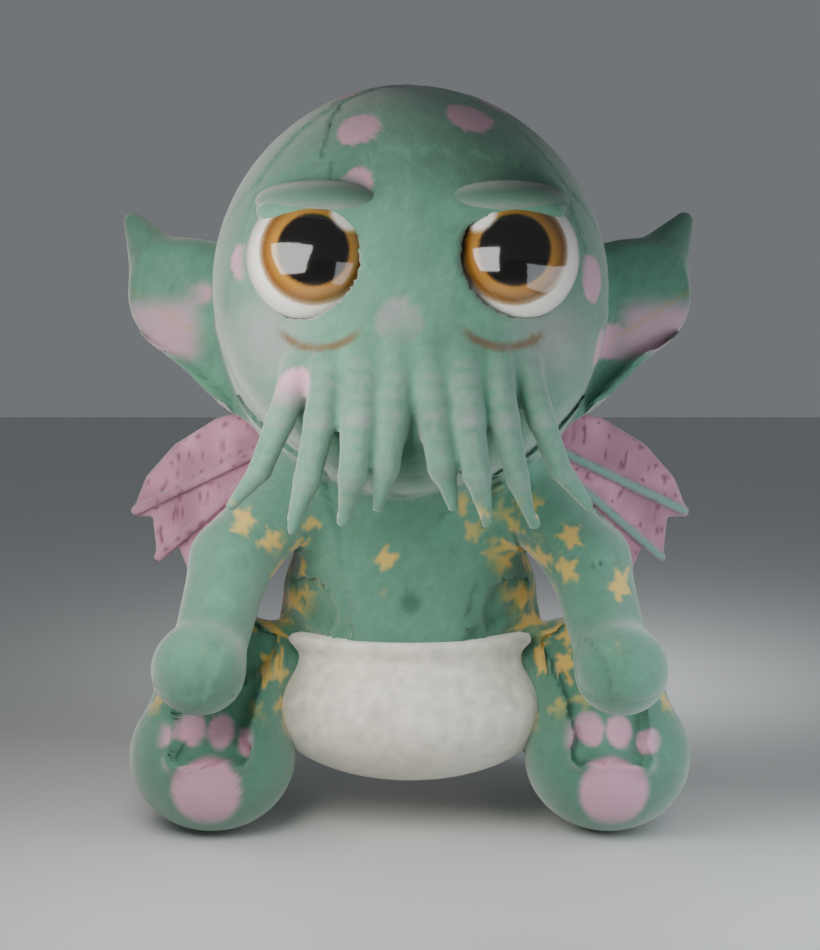
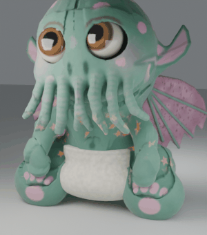
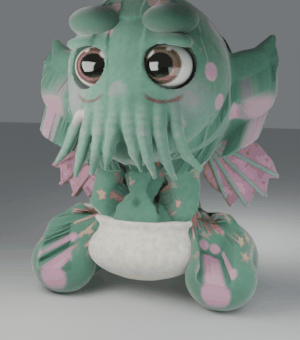
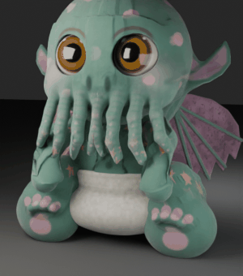

# Малыш Ктулху — фетровая кукла (3D)

Процедурная 3D-модель плюшевого «малыша Ктулху» по референсу: войлочный фетр,
розовые пятна-аплакации, вышитые звёзды, подгузник из махровой ткани,
крылья-перепонки с крапом, восемь тонких щупалец с розовыми присосками.
Вся геометрия и роспись собираются кодом в Blender (SDF → меш → вершинные цвета → риг → анимации).



## Что внутри

| файл | что это |
|---|---|
| `models/plush_cthulhu_animated.glb` | **главный ассет**: меш + скелет (51 кость) + 4 клипа (Idle, Laugh, Cry, Angry), вершинные цвета |
| `models/plush_cthulhu.blend` | сцена Blender: модель, риг, NLA-треки, свет, камера |
| `site/index.html` | интерактивный вьюер (three.js): вращение, кнопки клипов |
| `previews/` | рендеры и GIF-превью анимаций |
| `reference/reference.png` | исходный референс |
| `src/` | весь исходный код модели |

## Анимации

| клип | длина | что происходит |
|---|---|---|
| **Idle** | 72 к / 2.4 с | дыхание, лёгкое покачивание, шевеление щупалец |
| **Laugh** | 48 к / 1.6 с | голова запрокидывается, корпус подпрыгивает, прищур, щупальца трясутся |
| **Cry** | 96 к / 3.2 с | голова опускается, всхлипывания, ладони тянутся к морде, дрожь |
| **Angry** | 60 к / 2.0 с | наклон вперёд, «пыхтение», тремор, крылья расправляются |

30 fps. В GLB клипы лежат именованными glTF-анимациями, в `.blend` — Actions + NLA-треки.

  

## Как посмотреть

**Локально:** откройте `site/index.html` (three.js грузится с CDN, нужен интернет);
`plush_cthulhu_animated.glb` должен лежать рядом.

**В своём движке:** импортируйте `models/plush_cthulhu_animated.glb` — обычный glTF 2.0
со скиннингом и вершинными цветами (`COLOR_0`, материал `felt`).
Масштаб: 1 юнит = 100 px референса, рост ≈ 4.0 юнита, origin под дном куклы, +Z вверх.

**Blender:** откройте `models/plush_cthulhu.blend`, анимации — на NLA-дорожках рига `PlushRig`.

## Как это сделано

1. `src/sdf_lib.py` — SDF-ядро: `smin/smax`, эллипсоиды, капсульные цепочки, 2D-полигоны для ушей и крыльев,
   `narrow_volume` + marching cubes, сварка вершин, лапласиан и проецирование на точную поверхность.
2. `src/plush/body.py` — анатомия по замерам референса: яйцевидная голова, лицевая пластина, надбровные валики,
   морда, нос-«две ноздри», 8 щупалец по координатам с картинки, уши-пластины, туловище, руки с кулачками,
   ноги-«подушки» со ступнями к камере и пальчиками.
3. `src/plush/wings.py` — крылья: полигон из 16 точек с вырезами по краю + «пальцы»-рёбра.
4. `src/plush/details.py` — глаза (огромный зрачок, янтарная радужка, белый ободок, два блика), подгузник
   оболочкой вокруг бёдер с закруглёнными вырезами под ноги, цвета всех объектов.
5. `src/plush/paint.py` — роспись вершинными цветами: фетровая шумовая текстура, пятна-аплакации
   (фибоначчи-раскладка по голове), звёзды-«вышивка» в цилиндрической развёртке конечностей,
   розовые подушечки лап, присоски на щупальцах, брови, румянец на щеках, стежки. Все цвета sRGB → linear.
6. `src/rig.py` — 51 кость; веса — гауссиана по расстоянию до кости + сглаживание по топологии меша,
   максимум 3 влияния на вершину (glTF-friendly).
7. `src/anim.py` — клипы процедурными кривыми (синусы, затухания), поддержка Blender 5.x.
8. `src/build_scene.py` — сборка сцены: веки-«кромка», материалы фетра (roughness 0.93, sheen,
   двухмасштабный bump-ворс), студийный свет, камера, рендер.
9. `src/export_glb.py` — экспорт GLB с NLA-клипами + сохранение `.blend`.

## Пересборка с нуля

```bash
pip install bpy fast-simplification trimesh scipy numpy pillow
python3 src/build_assets.py     # SDF → models/*.npz
python3 src/build_scene.py      # собрать сцену и сохранить .blend
python3 src/build_scene.py render   # hero-рендер Cycles
python3 src/export_glb.py       # models/plush_cthulhu_animated.glb
```

## Ограничения

- Роспись — вершинные цвета: мелкие детали (стежки, присоски, крап) видны, но не являются текстурой.
- В GLB материал упрощён до базового PBR с вершинными цветами (сложные шейдеры Blender не переносятся).
- Скиннинг автоматический (по расстояниям до костей): в крайних позах возможны лёгкие артефакты,
  штатные клипы проверены рендером.
